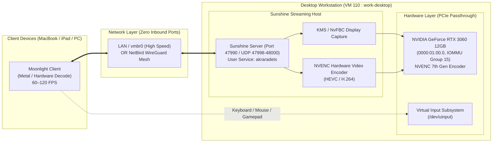

# Sunshine & Moonlight High-Performance GPU Streaming

This runbook documents the deployment, hardware acceleration, input configuration, and client pairing of **Sunshine** streaming to **Moonlight** clients using dedicated NVIDIA NVENC hardware acceleration on the homelab compute infrastructure.

---

## 1. Architectural Evolution & Hardware Strategy

During homelab compute prototyping on Proxmox VE, two GPU passthrough approaches were evaluated:

### A. Intel UHD 770 iGPU Passthrough (Evaluated & Retired)
* **Hardware**: Intel Core i5-13500 integrated graphics (`0000:00:02.0`).
* **Why It Was Retired**:
  1. **IOMMU Group 0 Collision**: On consumer LGA1700 motherboards, the iGPU is locked in IOMMU Group 0 alongside the CPU's primary Host Bridge (`0000:00:00.0`), preventing true PCIe hardware isolation.
  2. **Host vs. Guest Driver Contention**: The Proxmox host kernel claims the display engine on boot. When a guest VM accesses the GPU registers, DMAR remapping faults trigger kernel lockups.
  3. **Broken FLR (Function-Level Reset)**: Consumer Intel 12th/13th/14th Gen iGPUs lack PCIe FLR, causing hard VM and hypervisor crashes during display initialization or reboot.

### B. NVIDIA GeForce RTX 3060 12GB Passthrough (Standardized Architecture)
* **Target Host**: Workstation Desktop (`work-desktop`, VM 110 : `192.168.55.110`).
* **Hardware Address**: PCIe `0000:01:00.0` (Audio controller: `0000:01:00.1`).
* **IOMMU Group**: **Group 15** (Dedicated, 100% isolated PCIe slot).
* **Encoder**: **NVIDIA NVENC (Ampere 7th Gen)** supporting real-time H.264, HEVC (H.265), and AV1 encode at 60–120+ FPS with sub-millisecond host processing latency.



---

## 2. NVIDIA Driver & NVENC Prerequisites

On the workstation desktop guest node (`work-desktop`):

### Step 1: Install Official NVIDIA Drivers
```bash
sudo apt-get update
sudo apt-get install -y --no-install-recommends \
    nvidia-driver-550 \
    nvidia-utils-550
```

### Step 2: Verify GPU Passthrough & NVENC Health
Reboot the VM, then run:
```bash
nvidia-smi
```
Expected output:
* Driver Version: `550.x+`
* GPU: `NVIDIA GeForce RTX 3060` (12 GB VRAM)
* Persistence Mode: Enabled

---

## 3. User Groups & Virtual Input Permissions

Sunshine executes as the unprivileged user (`akraradets`) and injects virtual inputs via `/dev/uinput`.

### A. Group Memberships
Verify that `akraradets` belongs to the necessary hardware groups:
```bash
sudo usermod -aG video,render,input akraradets
```

### B. Configure `/dev/uinput` Udev Rule
```bash
# 1. Create udev rule for persistent uinput permissions
echo 'KERNEL=="uinput", GROUP="input", MODE="0660", OPTIONS+="static_node=uinput"' | sudo tee /etc/udev/rules.d/85-sunshine-input.rules

# 2. Reload and apply udev rules
sudo udevadm control --reload-rules
sudo udevadm trigger

# 3. Verify permissions (must show crw-rw---- root input)
ls -la /dev/uinput
```

---

## 4. Sunshine Installation & Service Configuration

### Step 1: Install Official Debian Package
```bash
# Fetch latest stable deb release from LizardByte GitHub releases
SUNSHINE_URL=$(curl -s https://api.github.com/repos/LizardByte/Sunshine/releases/latest \
  | grep "browser_download_url.*sunshine-ubuntu.*amd64.deb" \
  | cut -d : -f 2,3 \
  | tr -d \")

curl -fsSL -o /tmp/sunshine.deb "${SUNSHINE_URL}"
sudo apt-get install -y /tmp/sunshine.deb
rm -f /tmp/sunshine.deb

# Grant capabilities for KMS/display capture without root
sudo setcap cap_sys_admin+p "$(which sunshine)"
```

### Step 2: Configure Headless Operation & CSRF Whitelist
When running Sunshine as a headless background service without an interactive desktop display tray:

```bash
mkdir -p ~/.config/sunshine
cat << 'EOF' > ~/.config/sunshine/sunshine.conf
csrf_allowed_origins = https://192.168.55.110:47990,https://desktop.home.sinsamersuk.net:47990
system_tray = disabled
EOF
```

> [!IMPORTANT]
> Setting `system_tray = disabled` prevents Sunshine from exiting when Qt cannot initialize a desktop GUI tray icon in headless environments.

### Step 3: Enable Systemd User Service
LizardByte packages register the unit as `app-dev.lizardbyte.app.Sunshine.service`:

```bash
# 1. Enable lingering so the service survives SSH logout and starts on boot
sudo loginctl enable-linger akraradets

# 2. (Optional) Create a convenient 'sunshine' alias symlink
mkdir -p ~/.config/systemd/user
ln -sfn /usr/lib/systemd/user/app-dev.lizardbyte.app.Sunshine.service ~/.config/systemd/user/sunshine.service

# 3. Reload daemon and start
systemctl --user daemon-reload
systemctl --user start sunshine
```

Verify service status:
```bash
systemctl --user status sunshine
```

---

## 5. Web Interface Setup & Moonlight Pairing

### Step 1: Access Sunshine Web Configuration
1. Open your browser on macOS and navigate to:
   ```text
   https://192.168.55.110:47990
   ```
2. Accept the self-signed SSL/TLS certificate prompt.
3. **First-time setup**: Create an administrator username and password for Sunshine.

### Step 2: Pair with Moonlight Client
1. Open **Moonlight** on your Mac ([moonlight-stream.org](https://moonlight-stream.org/)).
2. Moonlight will automatically detect the host on the local subnet (`192.168.55.0/24`).
   *(If not discovered automatically, click **Add Host manually** and enter `192.168.55.110`).*
3. Click the host icon in Moonlight to generate a **4-digit PIN**.
4. In the Sunshine Web GUI (`https://192.168.55.110:47990`):
   * Navigate to the **PIN** tab in the top navigation bar.
   * Enter the 4-digit PIN shown in Moonlight.
   * Click **Send**.
5. Moonlight transitions to **Connected**. Click **Desktop** to launch the stream!

---

## 6. Recommended Moonlight Client Settings

In Moonlight's settings (gear icon on macOS):

| Setting | Value | Rationale |
| :--- | :--- | :--- |
| **Resolution** | `2560x1440` or `3840x2160` (4K) | High-fidelity rendering backed by 12GB VRAM |
| **Frame Rate** | `60 FPS` or `120 FPS` | Native ProMotion smoothness |
| **Video Bitrate** | `40–80 Mbps` | Flawless clarity over local virtual bridge |
| **Video Codec** | `HEVC` or `AV1` | Fast hardware decode on Apple Silicon with lowest bandwidth |
| **Host Processing Latency** | **1.0 – 2.5 ms** | Sub-millisecond frame delivery via NVIDIA NVENC |

### Clipboard Sharing & Keyboard Shortcuts (macOS $\leftrightarrow$ Linux)

Because the underlying GameStream protocol lacks a dedicated bidirectional clipboard channel, standard `Cmd+C` / `Ctrl+V` does not automatically sync across the stream. Use one of the following methods:

1. **Built-in Moonlight "Paste Clipboard Text" Shortcut (Mac $\rightarrow$ Linux Host)**:
   * Copy text on your MacBook (`Cmd + C`), focus the target window inside the Moonlight stream, and press:
     ```text
     Control + Option + Shift + V
     ```
   * Moonlight reads your macOS clipboard and types the string character-by-character into the remote Linux session via `/dev/uinput`.
2. **Bidirectional Background Clipboard Sync (KDE Connect)**:
   * Install `kdeconnect` on the Ubuntu workstation (`sudo apt install -y kdeconnect`) and the [KDE Connect macOS client](https://kdeconnect.kde.org/download.html) on your MacBook.
   * Pair both devices over the `192.168.55.0/24` LAN or NetBird mesh for automatic two-way clipboard synchronization.
3. **Shared TrueNAS Home Directory (`pool-1/home`)**:
   * With `/mnt/pool-1/home/akraradets` mounted via NFS on the Linux workstation and via SMB on macOS (see [[truenas|TrueNAS SMB Sharing]]), files and snippets saved to your home directory are immediately accessible on both machines.

---

## 7. Network Port Reference

| Port | Protocol | Purpose |
| :--- | :--- | :--- |
| `47990` | TCP | Sunshine Web Management Interface (HTTPS) |
| `47984` | TCP | HTTPS Server / Web API |
| `47989` | TCP | HTTP Server |
| `47998` | UDP | Video Stream |
| `47999` | UDP | Control Stream |
| `48000` | UDP | Audio Stream |
| `48010` | UDP | Microphone Stream |

> [!TIP]
> **Zero Inbound Router Ports**:
> Outside the home, connect Moonlight directly through **NetBird WireGuard Mesh** (`192.168.55.110`). Zero open ports are required on your residential router.

---

## 8. Related Documentation

- [[workstation|Workstation & Dev Environments]]: Multi-node compute architecture, identity alignment (UID 3000), and TrueNAS NFS storage.
- [[proxmox|Proxmox VE Hypervisor]]: PCIe hardware mappings (`nvidia-rtx3060` in IOMMU Group 15).
- [[truenas|TrueNAS SCALE Storage]]: User persistent home datasets (`/mnt/pool-1/home`).
- [[netbird|NetBird Remote Access]]: Subnet router configuration for zero-open-port streaming.
