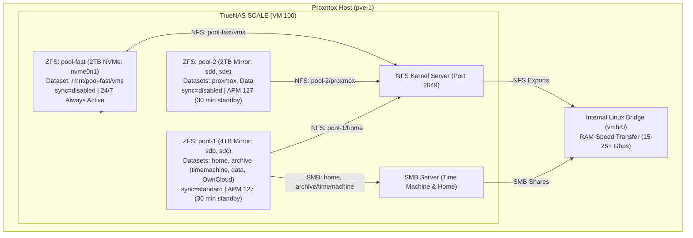
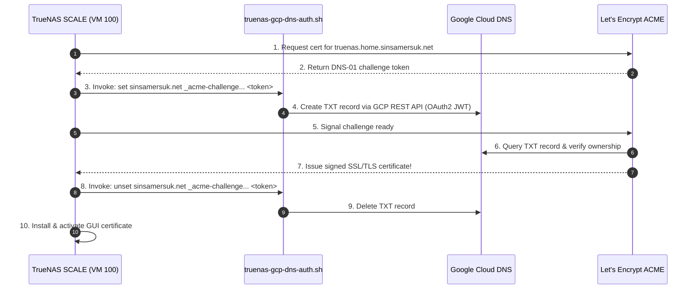

# TrueNAS SCALE Storage Appliance Configuration & Architecture

This document details the configuration, ZFS storage pool design, dataset tuning, sharing services, and automated SSL certificate management for the virtualized **TrueNAS SCALE** appliance (`vm_id = 100`).

---

## 1. Virtual Appliance Architecture & Hardware Passthrough

TrueNAS SCALE runs as a virtualized storage appliance on Proxmox VE (`pve-1`), directly controlling physical disk controllers via PCIe passthrough:

* **VM ID**: `100` (`name: truenas-scale`)
* **Static IP**: `192.168.55.100` (`truenas.home.sinsamersuk.net`)
* **Compute Resources**:
  * **vCPUs**: 4 Cores (Type: `host`)
  * **RAM**: **32,768 MB (32 GB)** Fixed Dedicated Memory
  * **Memory Ballooning**: **Strictly Disabled** (ZFS ARC requires deterministic, non-reclaimable RAM to prevent kernel panics)
* **Firmware & Display**:
  * Machine: `q35`
  * BIOS: `ovmf` (UEFI)
  * Display: `virtio` (VirtIO-GPU with 32MB VRAM fixes text garbling under OVMF console)
* **PCIe Passthrough Devices**:
  * `hostpci0`: Intel Raptor Lake SATA Controller (`0000:00:17.0`) $\rightarrow$ Direct AHCI control of physical SATA ports.
  * `hostpci1`: PNY CS3030 2TB NVMe SSD (`0000:03:00.0`, Phison E12) $\rightarrow$ Direct control of fast NVMe controller.



---

## 2. Storage Pool Layout & Physical Disk Inventory

TrueNAS organizes storage into three distinct tiers based on performance, capacity, and power efficiency:

| Pool Name | Physical Device | Model / Serial Number | Disk Size | Layout / Topology | Datasets & Roles | Power & Sync Settings |
| :--- | :--- | :--- | :--- | :--- | :--- | :--- |
| **`boot-pool`** | `sda` | Virtual SCSI (`drive-scsi0`) | 32 GiB | Virtual Disk (`local-lvm`) | • TrueNAS Appliance Root OS | Default |
| **`pool-fast`** | `nvme0n1` | PNY CS3030 (`PNY212021051901002DF`) | 1.82 TiB (2TB) | Single-disk Stripe (NVMe) | • `vms` (Proxmox VM root disks) | `sync=disabled`, `atime=off`<br>Always Active (No Spindown) |
| **`pool-1`** | `sdb`<br>`sdc` | Seagate IronWolf 5400 RPM<br>• `sdb` (`WW61G97T`)<br>• `sdc` (`WW64P7V0` ST4000VN006) | 3.64 TiB<br>3.64 TiB | Mirror (`mirror-0`)<br>(~3.64 TiB Usable) | • `home` (User vaults, `.ssh`, `projects`)<br>• `archive/timemachine` (Apple Time Machine)<br>• `archive/data` (Cold storage)<br>• `archive/OwnCloud` (Archived files) | `sync=standard`<br>**APM: 127**<br>**HDD Standby: 30 min** |
| **`pool-2`** | `sdd`<br>`sde` | Western Digital 2TB<br>• `sdd` (`WD-WXP2A1338SC8`)<br>• `sde` (`WD-WXN2D43NSZX4`) | 1.82 TiB<br>1.82 TiB | Mirror (`mirror-0`)<br>(~1.82 TiB Usable) | • `proxmox` (ISOs, VM backup snapshots)<br>• `Data` (General archive) | `sync=disabled`<br>**APM: 127**<br>**HDD Standby: 30 min** |

---

## 3. Dataset Tuning & Power Management Rationale

### A. Fast VM Disks (`pool-fast/vms`)
* **Path**: `/mnt/pool-fast/vms`
* **Sync Behavior**: **`sync=disabled`**
* **Rationale**:
  * Guest operating systems (ext4 journals, databases) issue frequent `fsync` calls over NFS.
  * Because consumer NVMe SSDs lack enterprise Power Loss Protection (PLP) capacitors, synchronous flushes cause severe latency penalties (dropping write IOPS from ~200,000 down to ~2,000).
  * Setting `sync=disabled` commits writes directly into TrueNAS RAM (ZFS Transaction Groups), flushing asynchronously every 5 seconds.
  * **Result**: Near-memory write speeds (**~15–25+ Gbps**) across the `vmbr0` virtual bridge.
  * **Integrity**: ZFS Copy-on-Write (CoW) guarantees the storage filesystem structure will never corrupt. In an ungraceful host crash, only the last up-to 5 seconds of in-flight VM writes could be lost.

### B. HDD Power Management & Spindown Architecture (All Mechanical Drives)
All mechanical hard drives across both `pool-1` and `pool-2` (`sdb`, `sdc`, `sdd`, `sde`) share an identical energy and acoustic profile:
* **Advanced Power Management (APM)**: **Level 127** (Permits platter spin-down while keeping drive electronics responsive to I/O).
* **HDD Standby Timer**: **30 Minutes** (Drives remain spinning during active work sessions, parking platters and spinning down only after 30 minutes of continuous idle to prevent excessive Start/Stop mechanical fatigue).
* **Homelab Acoustic Rationale**:
  * Because 24/7 VM root disks and active container workloads live exclusively on the silent **`pool-fast` NVMe**, mechanical drives remain spun down when not in use.
  * The 30-minute window ensures the drives only experience 1–3 gentle spin cycles per day (e.g. overnight or extended idle) rather than aggressive thrashing.

### C. User Vaults, Projects, Archive & Time Machine (`pool-1`)
* **User Vaults & Projects Dataset**: `/mnt/pool-1/home` (~685 GiB)
  * Owner: `root` (UID 0), Group: `root` (GID 0), Mode: `755`
  * Subdirectories: `/mnt/pool-1/home/<username>/` (Mode `750`, owned by `<username>`)
    * `.ssh/` (Centralized key pairs, config, authorized_keys)
    * `projects/` (Personal Git repositories, code, and project assets)
    * `documents/` (Personal files)
  * Purpose: User persistent assets and projects isolated from desktop cache bloat.
* **Archive Dataset**: `/mnt/pool-1/archive` (~975 GiB)
  * **`archive/timemachine`** (~780 GiB): Dedicated Apple Time Machine storage with hard quota enforced (e.g. 1.5 TB) to prevent indefinite pool growth.
  * **`archive/data`** (~120 GiB): Cold storage and historical files.
  * **`archive/OwnCloud`** (~76 GiB): Archived cloud storage data.

---

## 4. NFS Shares Configuration

TrueNAS exports storage over NFS to Proxmox and client workloads.

### Export 1: Fast VM Storage
* **Dataset Path**: `/mnt/pool-fast/vms`
* **Description**: `Proxmox Shared VM Storage`
* **Authorized Networks**: `192.168.55.0/24`
* **Advanced Permissions**: Maproot `root:root`, Security `sys`

### Export 2: Proxmox ISO & Backup Storage
* **Dataset Path**: `/mnt/pool-2/proxmox`
* **Description**: `Proxmox Storage (ISOs, Backups, Snippets)`
* **Authorized Networks**: `192.168.55.0/24`
* **Advanced Permissions**: Maproot `root:root`

### Export 3: User Storage & Projects (Multi-User & LDAP Ready)
* **Dataset Path**: `/mnt/pool-1/home`
* **Description**: `Centralized User Vaults & Projects`
* **Authorized Networks**: `192.168.55.0/24`
* **Advanced Permissions**: Maproot `root:root` (allows `pam_mkhomedir` / admin provisioning)

---

## 5. SMB Sharing & User Identity Alignment

* **Standardized Identity**:
  * Username: **`akraradets`**
  * UID: **`3000`**
  * Primary Group: **`akraradets`** (GID `3000`)
* **SMB Shares**:
  * **`home`**: Path `/mnt/pool-1/home` with **`Use as Home Share` enabled** (automatically maps users to `/mnt/pool-1/home/%U`, giving immediate Finder access to `projects/` and personal files).
  * **`TimeMachine`**: Path `/mnt/pool-1/archive/timemachine` with **Time Machine** multi-user option enabled for automatic macOS Bonjour discovery.

---

## 6. Data Protection: Snapshots, Scrubs & Disaster Recovery

TrueNAS enforces declarative data protection across all storage pools to guarantee resilience against human error, ransomware, drive failure, and silent bitrot.

### A. Periodic ZFS Snapshot Policy

ZFS snapshots are instantaneous point-in-time state records that consume zero additional space until underlying data blocks are modified or deleted:

| Dataset Target | Frequency | Retention Schedule | Recursive? | Purpose & Protection Scope |
| :--- | :--- | :--- | :--- | :--- |
| **`pool-1/home`** | Daily (00:00) | **14 Days** Rolling | **Yes** | User vaults, `.ssh` credentials, and Git projects against accidental deletion or ransomware. |
| **`pool-fast/vms`** | Daily (03:00) | **7 Days** Rolling | **Yes** | Quick rollback for Proxmox guest VM root disk filesystems before major updates. |
| **`pool-1/archive/timemachine`** | *Disabled* | N/A | No | Omitted intentionally; Apple Time Machine natively manages its own sparsebundles. |

#### Client-Side Snapshot Recovery (Zero GUI Dependency)
Users can restore accidentally deleted or corrupted files directly from any client workstation without opening the TrueNAS GUI:
```bash
# Browse snapshots for user akraradets on the workstation
ls -la /mnt/pool-1/home/akraradets/.zfs/snapshot/

# Restore a deleted file from yesterday's snapshot:
cp /mnt/pool-1/home/akraradets/.zfs/snapshot/auto-2026-10-18_00-00/projects/app/main.go ~/projects/app/
```

### B. ZFS Scrub Schedules (Integrity & Bitrot Self-Healing)

ZFS scrubs cryptographically verify every stored data block against its hash checksum. If bitrot or physical sector corruption is detected on a drive, ZFS automatically recalculates and writes clean parity data from the mirror pair:

| Pool | Physical Drives | Schedule | Frequency | Rationale |
| :--- | :--- | :--- | :--- | :--- |
| **`pool-fast`** | 1x 2TB NVMe | Every 2nd Sunday (02:00) | **14 Days** | High-velocity VM disk operations verified quickly on NVMe. |
| **`pool-1`** | 2x 4TB Mirror | 1st Sunday of Month (03:00) | **30 Days** | Monthly scrub prevents excessive mechanical platter wear while ensuring archive integrity. |
| **`pool-2`** | 2x 2TB Mirror | 15th of Month (03:00) | **30 Days** | Staggered from `pool-1` to avoid concurrent I/O load on the SATA controller. |

### C. Physical Drive Health (S.M.A.R.T. Monitoring)
* **Background Monitoring (`smartd`)**: TrueNAS continuously polls drive hardware attributes (reallocated sectors, pending sectors, temperature limits) every 30 minutes.
* **Proactive Alerts**: Any critical threshold excursion immediately dispatches an alert banner to the TrueNAS management interface and configured administrative channels.

---

## 7. Automated ACME DNS-01 SSL Certificates (Google Cloud DNS)

The TrueNAS Web GUI (`https://192.168.55.100`) uses valid Let's Encrypt SSL/TLS certificates issued and renewed with **zero inbound ports** using ACME DNS-01 challenges and Google Cloud DNS.

### Architecture Flow



### Persistent Authenticator Files
Custom scripts on TrueNAS SCALE reside on persistent storage (`pool-1`):
* **Script Path**: `/mnt/pool-1/scripts/acme/truenas-gcp-dns-auth.sh`
* **Key Path**: `/mnt/pool-1/scripts/acme/gcp-sa.json`

> [!NOTE]
> The shell authenticator [`scripts/truenas-gcp-dns-auth.sh`](file:///Users/akraradets/Projects/sinsamersuk/homelab/scripts/truenas-gcp-dns-auth.sh) is self-contained. It uses built-in Linux utilities (`bash`, `curl`, `openssl`, and standard `python3`) to sign a JWT and interact directly with Google Cloud DNS REST API. Zero extra packages (`gcloud` SDK, `pip`, or `jq`) are required.

### Configuration in TrueNAS Web GUI

#### Step 1: ACME DNS-01 Authenticator
1. Navigate to: **Credentials** $\rightarrow$ **Certificates**.
2. Under **ACME DNS-Authenticators**, click **Add**:
   * **Authenticator**: `Shell`
   * **Name**: `gcp-dns-auth`
   * **Path to Script**: `/mnt/pool-1/scripts/acme/truenas-gcp-dns-auth.sh`
   * **Running User**: `root`
   * **Certificate Timeout**: `120`
   * **Domain Propagation Delay**: `30`
3. Click **Save**.

#### Step 2: Certificate Signing Request (CSR) & Issuance
1. Under **Certificate Signing Requests**, click **Add**:
   * **Identifier**: `truenas-csr`
   * **Common Name**: `truenas.home.sinsamersuk.net`
   * Click **Save**.
2. In the CSR list, click the **wrench icon** (or 3-dots $\rightarrow$ **Create ACME Certificate**):
   * **Identifier**: `truenas-cert`
   * **Terms of Service**: Check the box to accept.
   * **Authenticator**: Select `gcp-dns-auth`.
   * **Renew Certificate Days**: `30`.
   * Click **Save**.

#### Step 3: Assign to Web GUI
1. Navigate to: **System Settings** $\rightarrow$ **General**.
2. Under **GUI**, click **Settings**.
3. In **GUI SSL/TLS Certificate**, select **`truenas-cert`**.
4. Click **Save** and confirm the web interface restart.

### Verification
```bash
curl -Iv https://truenas.home.sinsamersuk.net 2>&1 | grep -E "subject|issuer|verify ok"
```
Output:
```text
*  subject: CN=truenas.home.sinsamersuk.net
*  issuer: C=US; O=Let's Encrypt; CN=YR1
*  SSL certificate verify ok.
```
