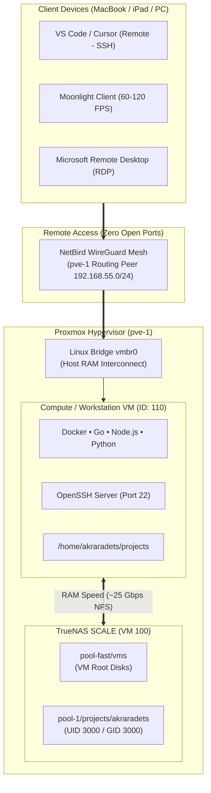

# Workstation & Development Environment Architecture

This runbook documents the compute workstation architecture, user identity alignment, storage integration with TrueNAS SCALE, and the evaluation of remote access protocols for the homelab.

> [!NOTE]
> **Current Lifecycle Status**:
> The `work-desktop` VM (`vm_id = 110`) was wiped from Proxmox and commented out in [`terraform/proxmox/110-work-desktop.tf`](file:///Users/akraradets/Projects/sinsamersuk/homelab/terraform/proxmox/110-work-desktop.tf). Its storage bindings, identity framework (UID 3000), and provisioning scripts are documented below in preparation for the next-generation compute environment.

---

## 1. Core Architecture & Specifications

The homelab compute layer runs virtualized on Proxmox VE (`pve-1`), communicating directly with TrueNAS SCALE (`vm_id = 100`) across the virtual bridge (`vmbr0`) at **near-memory speeds (~15–25+ Gbps)**.

| Parameter | Specification | Architectural Rationale |
| :--- | :--- | :--- |
| **VM ID** | `110` (`work-desktop`) | Standardized VM sequencing (`order = 2`, boots after TrueNAS) |
| **Host Hypervisor** | Proxmox VE 9.2 (`pve-1`) | Intel Core i5-13500 (Raptor Lake, 20 vCPUs, UHD 770 iGPU) |
| **Target OS** | Ubuntu 24.04 LTS (Noble) | Long-term support, broad container & tooling support |
| **Primary User** | `akraradets` | Standard homelab administrator identity |
| **UID / GID** | **`3000` / `3000`** | **Strictly matches TrueNAS ZFS dataset ownership** |
| **Network IP** | `192.168.55.110/24` | Static internal assignment on `vmbr0` |
| **Internal FQDN** | `desktop.home.sinsamersuk.net` | Resolves via internal Cloud DNS |
| **Storage Datastore**| `truenas-fast` (NFS) | High-speed NVMe backed VM disks (`sync=disabled`) |



---

## 2. Remote Access Protocols: Architectural Evaluation

During prototype testing on Ubuntu 24.04, three remote access approaches were evaluated:

### Approach A: Headless Linux Dev VM + VS Code Remote - SSH (Recommended)
* **How It Works**: The VM runs headless with OpenSSH, Docker, and dev toolchains. VS Code or Cursor connects from macOS via the **Remote - SSH** extension over NetBird (`ssh akraradets@desktop.home.sinsamersuk.net`).
* **Why It Is Superior**:
  - **Zero Display Latency**: Editor UI, typing, scrolling, and window management render natively on macOS at full Retina resolution and 120Hz ProMotion.
  - **Zero Codec/Bandwidth Overhead**: Only code diffs and terminal text are sent over the network; zero video streaming or compression artifacts.
  - **Native Battery Life**: No video decoders active on the client laptop.
  - **Compute Offload**: Heavy compilation, Docker containers, and test suites execute on the 14-core Intel i5-13500 hypervisor.

### Approach B: Sunshine + Moonlight with Dedicated GPU (Standardized for VM 120)
* **How It Works**: High-performance game and desktop streaming using [Sunshine](https://github.com/LizardByte/Sunshine) paired with [Moonlight](https://moonlight-stream.org/) client.
* **Standardized Hardware**: Dedicated **NVIDIA GeForce RTX 3060 12GB** (`0000:01:00.0`, IOMMU Group 15) passed to **`work-compute` (VM 120)** using NVENC hardware acceleration.
* **Architectural Learning (Intel UHD 770 Passthrough Retired)**:
  - Intel Core i5-13500 integrated graphics (`0000:00:02.0`) sits in **IOMMU Group 0** with the CPU Host Bridge memory controller, suffers from driver contention with the Proxmox host's `i915`, and lacks PCIe FLR (Function-Level Reset), causing VM and hypervisor kernel lockups.
  - Full PCIe GPU passthrough is standardized exclusively on the dedicated NVIDIA GPU (IOMMU Group 15). See [[sunshine|Sunshine GUI Streaming Runbook]].

### Approach C: Traditional XRDP / Microsoft Remote Desktop (Evaluated & Retired)
* **How It Works**: `xrdp` and `xrdp-sesman` spawn virtual X11 displays (`:10`) on user login.
* **Why It Was Retired**:
  - **CPU Rasterization**: Cloud images running without dedicated virtual GPU acceleration render GNOME via software (`llvmpipe`), causing sluggish 10–15 FPS refresh rates and high CPU usage.
  - **NetBird Web Client Latency**: Accessing RDP via the NetBird web browser dashboard routes through cloud TURN/relay proxies and HTML5 canvas rendering, resulting in ~200ms latency.
  - **Polkit & Session Complexity**: Multiple background authorization prompts (`colord`, `NetworkManager`) require custom polkit rules.

---

## 3. Storage Integration & Identity Alignment (UID 3000)

To prevent permission mismatch between the Linux workstation and TrueNAS ZFS storage, permissions are bound by a unified POSIX identity:

* **Username**: `akraradets`
* **UID**: `3000`
* **GID**: `3000`

### TrueNAS NFS Mount Configuration (1:1 Path Parity)

To ensure zero cognitive friction across all systems, TrueNAS paths are mounted with exact 1:1 path parity on all client nodes:

#### 1. Persistent Configuration (`/etc/fstab`)
```ini
# TrueNAS High-Speed Virtual Bridge NFS Export (1:1 Path Parity)
192.168.55.100:/mnt/pool-1/home  /mnt/pool-1/home  nfs  defaults,_netdev,bg,intr,noatime,nfsvers=4  0  0
```

#### 2. Local User Symlinks
To keep local `$HOME` on fast NVMe storage while centralizing credentials and code:
- `~/.ssh` $\rightarrow$ `/mnt/pool-1/home/akraradets/.ssh` (Centralized key pairs, config, authorized_keys)
- `~/projects` $\rightarrow$ `/mnt/pool-1/home/akraradets/projects` (Personal git repos & docker assets)

Because traffic travels over the virtual bridge (`vmbr0`) entirely in host RAM, reads and writes execute with near-memory throughput (~15–25+ Gbps).

---

## 4. Automated Workstation Provisioning

The repository provides two modular, idempotent scripts to provision compute nodes:

### Step 1: Base Machine Setup (`scripts/setup-workstation.sh`)
Automates machine-level essentials (runs once per node):
1. **OpenSSH Server & QEMU Guest Agent**: Installs and activates `openssh-server` and `qemu-guest-agent`.
2. **TrueNAS Storage**: Mounts `/mnt/pool-1/home` with 1:1 path parity in `/etc/fstab`.
3. **Docker Engine**: Installs official Docker CE, Compose plugin, and prepares Docker daemon.

```bash
scp scripts/setup-workstation.sh <bootstrap-user>@192.168.55.110:/tmp/
ssh <bootstrap-user>@192.168.55.110 "sudo bash /tmp/setup-workstation.sh"
```

### Step 2: User Account Creation (`scripts/setup-user.sh`)
Creates and aligns the user account:
1. **Interactive Prompt**: Prompts for `username` and `UID:GID` (defaults: `akraradets` and `3000:3000`), or accepts arguments `[username] [uid:gid]`.
2. **Identity Alignment**: Creates or migrates user and primary group to the specified `UID:GID`.
3. **Hardware & System Groups**: Adds user to `sudo`, `docker`, `video`, `render` (Intel UHD 770 `/dev/dri/renderD128` access), and `input` (Sunshine/Moonlight).
4. **Passwordless Sudo**: Configures validated `/etc/sudoers.d/<username>`.

```bash
# Run interactively (prompts for username and uid:gid)
scp scripts/setup-user.sh <bootstrap-user>@192.168.55.110:/tmp/
ssh -t <bootstrap-user>@192.168.55.110 "sudo bash /tmp/setup-user.sh"

# Or pass arguments directly
ssh <bootstrap-user>@192.168.55.110 "sudo bash /tmp/setup-user.sh akraradets 3000:3000"
```

### Step 3: TrueNAS Vault Linking (Manual Snippet)
Once the user account exists and `/mnt/pool-1/home` is mounted, run the following commands to initialize the vault and create symlinks:

```bash
# 1. Initialize vault directories on TrueNAS (run with sudo)
sudo mkdir -p /mnt/pool-1/home/akraradets/.ssh
sudo mkdir -p /mnt/pool-1/home/akraradets/projects
sudo chown -R 3000:3000 /mnt/pool-1/home/akraradets
sudo chmod 700 /mnt/pool-1/home/akraradets/.ssh

# 2. (Optional) Copy over existing authorized_keys if present
sudo cp ~/.ssh/authorized_keys /mnt/pool-1/home/akraradets/.ssh/ 2>/dev/null || true
sudo chown 3000:3000 /mnt/pool-1/home/akraradets/.ssh/authorized_keys 2>/dev/null || true
sudo chmod 600 /mnt/pool-1/home/akraradets/.ssh/authorized_keys 2>/dev/null || true

# 3. Create persistent symlinks in local home (run as user akraradets)
ln -sfn /mnt/pool-1/home/akraradets/.ssh ~/.ssh
ln -sfn /mnt/pool-1/home/akraradets/projects ~/projects
```

---

## 5. Related Documentation

- [[architecture|Homelab Architecture]]: Complete system topology, networking, and DNS runbook.
- [[proxmox|Proxmox VE Hypervisor]]: Hardware specs, PCIe passthrough, and VM startup sequencing.
- [[truenas|TrueNAS SCALE Storage]]: ZFS pool layout, fast NVMe dataset tuning, and NFS exports.
- [[netbird|NetBird Remote Access]]: Subnet router configuration and WireGuard peer mesh.
